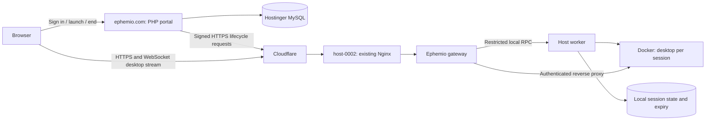

# Ephemio ephemeral desktops POC

Prepared 2026-10-04 after read-only inspection of both servers. This is an
implementation plan; no remote files, databases, containers, or configuration
were changed during planning. The subsequent authorized deployment is recorded
in [DEPLOYMENT.md](DEPLOYMENT.md).

## Outcome and initial scope

A provisioned tester signs in with email and password at `ephemio.com`, launches
a temporary Ubuntu KDE desktop, opens it in their browser, reconnects while it
is active, and ends it. Expiry also destroys the desktop and its home. Audio
plays in the viewer's browser. The dashboard shows status and remaining time.

Proposed POC defaults: invited testers, one active desktop per user, one desktop
total on host-0002, 30-minute sessions, and a configurable 60-minute ceiling.
The deadline starts when the host accepts provisioning; allow at most five
minutes to become ready. Closing a tab leaves the desktop active until end or
expiry. No idle-based expiry in the first iteration. Billing, public signup,
saved desktops, collaboration, additional images, and live migration follow
after the basic lifecycle works.

## Inspected infrastructure

| Location | Observed state | POC role |
| --- | --- | --- |
| Hostinger, `46.202.172.87:65002` | PHP CLI 8.2.33, versioned PHP binaries through 8.5, Composer, PDO MySQL and cURL; existing PHP application | Website, authentication, session database and host selection |
| VPS, `137.74.12.96` | 6 vCPUs, approximately 12 GiB RAM, no swap, 54 GiB free on a 96 GiB ext4 disk; Docker and Compose available | First desktop host |
| VPS Nginx | Serves several projects on ports 80/443; Certbot installed | Additional virtual host for Ephemio |
| `host-0002.ephemio.com` | HTTPS succeeds through Cloudflare, currently returns 404; no matching Nginx server block | Host API and authenticated desktop gateway |
| Existing containers | LiveKit, inference jobs, Onlys worker, llama.cpp | Existing load to account for in admission and runtime checks |

At inspection, Linux reported roughly 8 GiB available memory. Existing container
memory limits total about 10 GiB, so this snapshot is not reserved capacity for
desktops. `/dev/dri` and `/dev/kvm` exist; neither proves useful GPU acceleration
or usable nested virtualization. Start with CPU streaming.

The site root is `/home/u325484590/domains/ephemio.com/public_html/`. Its parent
contains the old application, `.env`, and a separate legacy JSON configuration.
Database connectivity and schema have not been verified in this inspection.
The sibling `../ephemio-website` repository contains the old PHP implementation,
including identity, CSRF, rate limiting, and database helpers. Review these as
reuse candidates; the retired workload/agent API is not the new service contract.

## Architecture



Use PHP for the portal to fit Hostinger. Implement the host services in Python with aiohttp, matching the VPS Python
runtime and supporting HTTP and WebSocket streaming. One codebase can provide two systemd
services: an unprivileged HTTP gateway and a Docker-capable worker reachable
only through a permission-restricted Unix socket. The worker owns local SQLite
state, provisioning, cleanup, and the expiry loop. The gateway has no Docker
socket; its local RPC exposes only the approved session operations.

Use this repository for the runtime, protocol, deployment templates, and this
plan. Implement the PHP portal changes in `../ephemio-website`, its existing
deployment repository. Deploy the host services under `/opt/ephemio`, state
under `/var/lib/ephemio`, and secrets under `/etc/ephemio` with restrictive
permissions. The web root contains only public PHP entry points and assets.

## Credentials and browser access

1. An administrator creates tester accounts through a CLI command. Store password
   hashes using PHP's password functions; rate-limit login and protect mutations
   with CSRF tokens. Use host-only Secure, HttpOnly account cookies.
2. The user clicks **Launch desktop**. The portal creates an owned session record,
   reserves an eligible host slot, and sends an idempotent creation request.
   The host durably accepts work and returns promptly; image pulls and desktop
   startup run in the worker. The dashboard polls progress.
3. **Open desktop** rechecks account ownership and active state. The portal asks
   the selected host to mint a random, single-use connection ticket valid for
   60 seconds. The host stores its hash, account/session binding, and expiry.
4. A form POST sends that ticket to the host's `/connect` endpoint in a new tab.
   Restrict the POST Origin to `https://ephemio.com`, send strict-origin/no-store
   headers (an origin is needed for the browser POST origin check), and never put tickets in URLs or logs. The gateway consumes the
   ticket atomically and creates a host-only Secure, HttpOnly cookie before
   redirecting to `/desktop/<opaque-session-id>/`.
5. The gateway authorizes every HTTP request and WebSocket upgrade against that
   account/session and local lifecycle state. Reject foreign WebSocket Origins.
   Strip portal/gateway cookies and client-supplied proxy/auth headers before
   forwarding to the container. The destination comes only from worker state.
6. Gateway access expires after five minutes or at the desktop deadline, whichever
   comes first. A portal connection page renews access while the account remains
   authenticated, through fresh POSTed tickets and exact-origin messaging.
   Reopening from the dashboard is the fallback if the portal tab is closed.
   Renewal changes the gateway grant, never the desktop's fixed deadline.
7. End, expiry, logout, and account disabling revoke access. The gateway tracks
   and closes existing WebSockets on revocation or grant expiry; checking only
   the initial upgrade would leave an open stream usable. If immediate logout
   revocation cannot reach the host, the five-minute grant is the upper bound.

The customer uses their Ephemio credentials once; no SSH or shared desktop
password is exposed. Disable Webtop's own sharing/collaboration links. Container
ports remain private, accessible only through the authorized gateway.

Paths under one hostname share a browser origin: path-scoped authorization is
not browser isolation against malicious content served by a compromised guest.
Limit this POC to trusted testers; separate desktop origins are a prerequisite
to evaluate before public multi-tenant access.

## Host API and pool scheduling

Each host has a unique ID, base URL, enabled/draining state, allowed image digest,
slot limit, resource budget, health timestamp, and a separate request-signing key.
Start with `host-0002`; adding hosts should be configuration, not application code.

| Endpoint on host | Purpose |
| --- | --- |
| `GET /agent/v1/health` | Authenticated health, capacity and reconciliation status |
| `PUT /agent/v1/desktops/{id}` | Idempotently accept a session with immutable spec and deadline |
| `GET /agent/v1/desktops/{id}` | Observe provisioning, readiness, failure or cleanup |
| `DELETE /agent/v1/desktops/{id}` | Revoke access and request repeatable destructive cleanup |
| `POST /agent/v1/desktops/{id}/tickets` | Mint a short-lived browser connection ticket |
| `POST /agent/v1/grants/revoke` | Revoke grants for an account login session |

Authenticate server requests with per-host HMAC-SHA256 over method, canonical
path, timestamp, nonce, and exact body hash. Reject clock skew beyond 30 seconds,
replayed nonces, invalid signatures, and oversized requests. TLS verification
is mandatory. Keep signing keys outside the web root and all guest containers;
never expose them to browser JavaScript. Public health responses reveal no
capacity or container details.

Select a healthy enabled host with a free reserved slot. Reserve atomically in
MySQL; the worker independently enforces its own limit. Host assignment becomes
fixed before creation. Retries use the same ID/spec and host. A timeout means
unknown state, not permission to launch a duplicate elsewhere. Reconcile with
the original host before releasing its slot; unreachable sessions remain
unknown until absence is observed. Draining hosts accept no new sessions.

Suggested MySQL tables: `users`, `auth_sessions`, `hosts`, `desktop_sessions`,
`session_events`, and `host_operations`. Record desired state, observed state,
host assignment, deadlines, request idempotency, and last observation separately.
Local host state records Docker identities, private routing, deadlines, grants,
and cleanup progress. No direct remote MySQL connection from VPS is required.

PHP requests attempt pending operations and refresh status. A VPS reconciliation
service polls a signed, host-scoped portal endpoint every 15 seconds for pending
work and reports observations. This also retries work after browser disconnects,
without depending on a resident PHP process or Hostinger cron. Expiry depends
only on the host worker and its durable deadline.

## Desktop lifecycle and resource controls

```text
requested -> provisioning -> active -> deleting -> deleted
```

Failures during provisioning enter deletion with a recorded reason. Stop requests
win over concurrent provisioning; late creation must never reactivate a deleted
ID. Store terminal tombstones so retried creation cannot resurrect expired work.

The worker records ownership and deadline before Docker operations. Give every
resource an Ephemio ownership label and session ID. On restart, reconcile only
owned containers, volumes and networks against local state; revoke or clean up
orphans. Never use global Docker prune or select resources merely by name.

Proposed first-host settings:

- One desktop slot, two CPUs, 3 GiB memory, 1 GiB shared memory within that budget,
  and an initial 512-process limit. Keep Docker's default seccomp/AppArmor;
  no privileged mode, host networking, Docker socket, or host-device passthrough.
- Pre-pull a tested Ubuntu KDE Webtop digest. Reject arbitrary images, mounts,
  host paths, ports, and Docker flags in API input. Use a fresh `/config` volume
  and private network per session; cap and rotate container logs.
- Admit only when at least 5 GiB memory and 20 GiB disk are currently available,
  with no other Ephemio desktop/reservation. Recheck at creation. Monitor pressure
  and terminate the POC desktop if memory falls below 2 GiB or free disk below
  15 GiB. These starting thresholds require measurement under existing app load.
- Monitor session home plus writable-layer growth; end a session exceeding a
  provisional 5 GiB usage limit. This is a sampled limit, not a hard disk quota
  on the current ext4/overlay2 setup. Hard storage quotas and stronger workload
  isolation must be settled before accepting untrusted public users.
- Permit browser internet access while blocking the host, management services,
  other Docker networks, private/link-local destinations, and host public-IP
  bypasses. Scope firewall changes to the Ephemio bridge and handle IPv6 too.
  Measure network use and impose a scoped bandwidth cap if it affects LiveKit.

Memory caps do not reserve capacity from other applications or guarantee against
a sudden host-wide OOM. This first shared-host POC is best effort for trusted
testers; capacity increases require measurements during inference and RTC load.

Run the expiry loop every five seconds. On end/expiry, deny connections, close
streams, stop/kill and remove the container, and delete its volume/network and
grant data. Verify absence before reporting `deleted` and releasing capacity.
An independent systemd timer invokes serialized cleanup if the main worker
fails. If Docker is unavailable, keep access revoked and retry; do not claim
deletion. Reconcile expired sessions before allowing gateway access after boot.

## HTTPS and streaming

Add a dedicated Nginx virtual host for `host-0002.ephemio.com`. Provision an origin
certificate for that name using existing Certbot (HTTP-01 if the proxied challenge
path is reachable), or Cloudflare Origin CA if required. Confirm Cloudflare uses
Full (strict) for this hostname. The working edge certificate alone does not
prove origin certificate validation; current Cloudflare mode is unverified.
Use a hostname-specific setting if the zone's other origins need different setup.
[Cloudflare origin TLS requirements](https://developers.cloudflare.com/ssl/origin-configuration/ssl-modes/full-strict/).

Nginx forwards to the local gateway, which proxies the desktop's internal HTTP
port 3000. Use `SUBFOLDER=/desktop/<id>/`, preserve that prefix, support WebSocket
upgrades, disable response buffering, and set long streaming timeouts. Bound
uploads to a POC size, initially 50 MiB. Validate the selected image's assets,
clipboard, upload/download, audio and reconnect behavior under this path before
building the dashboard around it. These proxy and subfolder mechanisms are
documented by [Selkies](https://docs.linuxserver.io/selkies/user-guide/reverse-proxy/).

Use Selkies' WebSocket transport initially. Cloudflare supports proxied
WebSockets, but connection interruptions still require reconnect handling.
Bypass caching and HTML rewriting for the host API, connection endpoints and
desktop routes. Video/audio bypass Hostinger entirely.
[Cloudflare WebSocket behavior](https://developers.cloudflare.com/network/websockets/).

## Delivery sequence and acceptance

1. **Native desktop and ingress:** establish a temporary credential-protected
   desktop route, origin certificate and resource limits. Demonstrate browser
   video/audio, typing, clipboard, small upload/download and reconnect. Capture
   CPU, memory and network use alongside existing projects.
2. **Host services:** implement signed API, idempotent async creation, durable
   state, resource admission, independent expiry, and cleanup. Verify duplicate
   launches, startup failure, end-during-start, worker restart, unavailable Docker,
   and expired-session recovery. Recovery testing must target Ephemio services;
   use an isolated environment for Docker daemon failure and host reboot tests.
3. **Portal and credentials:** fresh desktop schema, provisioned tester accounts,
   launch/status/open/end dashboard, ticket exchange and revocation. Verify two
   accounts cannot access each other's sessions, stolen/replayed/expired tickets
   fail, and revocation closes an already connected stream. Exercise grant renewal.
4. **Deploy and complete the POC:** replace the obsolete site/API and initialize
   the new schema. The user authorized removing old Ephemio files and tables;
   first resolve the database named in `.env` and verify it is dedicated to
   Ephemio. Retain the needed connection settings privately, standardize the new
   config format, and restrict `.env` to mode 0600. Deploy PHP private files
   outside `public_html`; remove stale public scripts and credentials artifacts.
5. **End-to-end acceptance:** from an ordinary browser, log in, launch, hear audio,
   reconnect, end and confirm removal; repeat using automatic expiry with the
   portal unavailable. Ensure a new desktop has no previous files. Test busy-host
   rejection and confirm existing inference/RTC applications remain healthy.

Deploy an additive Ephemio Nginx config, validate it, and reload Nginx rather than
restarting unrelated services. Rollback disables Ephemio admission, revokes and
cleans up its sessions, removes only its virtual host/services, and reloads Nginx.
The authorized database reset is destructive; use a protected temporary backup
before cutover if rollback to the old website is required.

Completion means the credentialed desktop lifecycle works on host-0002, expiry
survives portal outages, cleanup is observed, and the host registry can accept a
second host. It does not establish public multi-tenant isolation or production
capacity; those are subsequent milestones.
